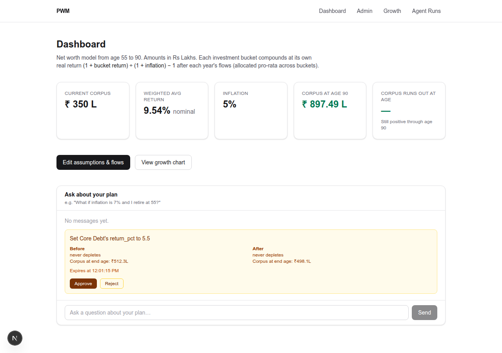
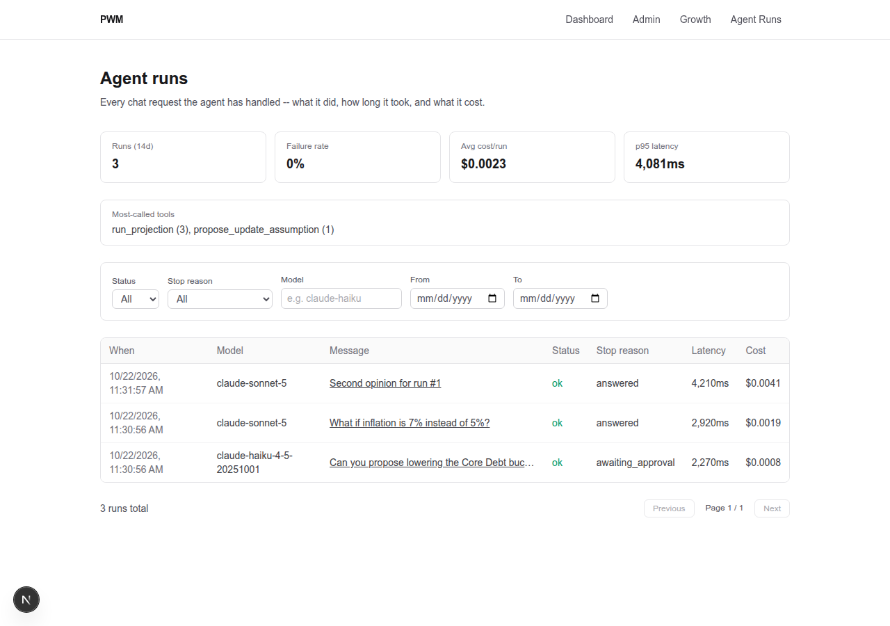
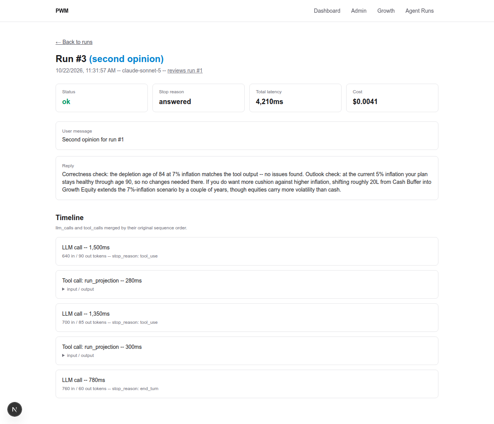

# PWM — Personal Wealth Management

A hands-on exploration of production AI agent patterns, built on a real tool: a retirement/net-worth projection app for the owner's own finances. The projection engine itself is unremarkable — deterministic arithmetic over investment buckets, inflation, and planned cash flows. What's underneath is the chat agent sitting on top of it, built and hardened in phases like production infrastructure rather than a weekend demo.

**What this demonstrates:**

- **Human-in-the-loop safety for an agent with write access** — the agent never writes directly; every change is staged as a proposal with a before/after impact snapshot, approved or rejected by a human, idempotently.
- **Tool use scoped by least privilege, not by trust** — an [MCP server](backend/src/mcp-server.ts) enforces two bearer-token scopes (read-only vs. read+propose) server-side; a caller only ever sees the tools its token grants.
- **Vendor-agnostic provider abstraction** — swapping LLM vendors or models is a DB row and a tested config entry in [`llm/`](backend/src/llm/), not a code change to the agent loop.
- **Full observability on every agent run** — cost, latency, retries, token usage, and a merged tool-call/LLM-call timeline, queryable from an [admin dashboard](frontend/app/admin/runs/page.tsx) with filters and aggregate stats.
- **A second, independent agent reviewing the first one's work** — an opt-in critic checks the primary agent's numeric claims against its own trace and suggests corrections, running on a separately-chosen model so it isn't grading its own homework.
- **An eval suite run against the real API** — 11 cases across 7 categories, multi-model comparison, each case repeated for a consistency measure — not vibes-based.

<p align="center">
  
  
  
</p>
<p align="center"><em>Left to right: the chat UI with a pending proposal, the observability dashboard, and the critic agent's review of another run — all using the app's built-in fictional demo data (<code>npm run seed:demo</code>), not real financial information.</em></p>

The rest of this README is the detailed engineering reference — how each piece works, the trade-offs behind it, and how to run it yourself.

## Stack

- **Backend**: Express + TypeScript + Postgres (`pg`), zod for validation
- **Frontend**: Next.js (App Router) + Tailwind
- **Agent**: `@anthropic-ai/sdk`, calling Claude with a typed tool layer over the same projection engine the dashboard uses
- **Infra**: Docker Compose, Postgres in its own container (`pgdb`) on an external `pwm-net` network

## How it works

- [backend/src/projection.ts](backend/src/projection.ts) — the only place that does math. `buildProjection` walks year by year, nets out flows/lump sums/SWP withdrawals, compounds each investment bucket at its own real (inflation-adjusted) return. Pure, deterministic, no I/O.
- [backend/src/data.ts](backend/src/data.ts) — all Postgres reads/writes.
- [backend/src/routes/api.ts](backend/src/routes/api.ts) — REST API the dashboard/admin screen use (`GET/PUT /api/settings`, `GET /api/projection`) plus the chat endpoint (`POST /api/chat`, streamed over SSE).
- [backend/src/tools.ts](backend/src/tools.ts) — a typed tool layer (zod schemas + handlers) wrapping the engine: `get_portfolio`, `get_buckets`, `get_expenses`, `run_projection` (read); `propose_update_assumption`, `propose_add_expense` (propose -- stage a change for approval, write nothing); `update_assumption`, `add_expense` (write -- never exposed to an agent, only reachable via the approval endpoint below and `tools.smoke.ts`). Only [backend/src/mcp-server.ts](backend/src/mcp-server.ts) imports this directly anymore — it's the single place that owns which tools exist and which ones are exposed.
- [backend/src/mcp-server.ts](backend/src/mcp-server.ts) — an MCP server over Streamable HTTP, exposing read and propose tools to any MCP client: Claude Desktop, this app's own in-house chat agent, or anything else that speaks MCP. A separate deployable service on purpose — different trust boundary than a trusted internal caller, own scaling/latency profile. Two scoped bearer tokens rather than one shared secret: `MCP_READ_TOKEN` (read-only tools) and `MCP_PROPOSE_TOKEN` (read + propose, a strict superset). Whichever token a caller presents *is* its scope — no identity/role lookup layer, since there's no concept of distinct users here, just a small fixed set of known callers. The server is stateless (builds a fresh tool registry per request), so scoping a tool out for a given caller means it's absent from both `tools/list` and `tools/call` — one mechanism, not two. This app's own agent uses the propose token; give external clients (Claude Desktop) the read token. Every call is logged with its scope (`[mcp] scope=... tool=... -> ok/error`); a `pending_actions`-style persisted/queryable audit log for this is deferred to the observability phase rather than half-built here.
- Human-in-the-loop approvals: a `propose_*` tool call creates a `pending_actions` row (proposed input + a before/after projection impact snapshot: depletion age, corpus at end age) and writes nothing else. `POST /api/actions/:id/approve` applies the write (via the same `update_assumption`/`add_expense` handlers, now transaction-aware) and flips the row's status; `/reject` just flips the status. Both are idempotent — deciding an already-decided row is a no-op, not a double-write. Pending actions lazily expire after `PENDING_ACTION_TTL_MINUTES` (default 30). `/api/actions/*` sits behind its own bearer token (`ACTIONS_AUTH_TOKEN`, separate from MCP's) since the caller here is the browser, not another backend process — see its env var entry below for the honest limits of that protection. The chat UI ([frontend/app/ChatPanel.tsx](frontend/app/ChatPanel.tsx)) renders a proposal card with Approve/Reject buttons whenever the agent proposes a change.
- [backend/src/agent.ts](backend/src/agent.ts) — the reason→act→observe loop for the in-app chat: gets an `LlmProvider` from `llm/registry.ts`, calls tools via an MCP *client* connection to `mcp-server.ts` (not a direct import), loops until a final answer. It knows nothing about Postgres, the projection engine, or any specific LLM vendor's SDK — only the canonical types in `llm/types.ts` and how to talk to an MCP server.
- [backend/src/llm/](backend/src/llm/) — the model-choice abstraction, one subdirectory per vendor. `types.ts` defines a vendor-agnostic `LlmProvider` interface (canonical message/tool/content types, with an `"opaque"` block type so vendor-specific extras like Anthropic's extended-thinking blocks can round-trip without leaking into the interface); `registry.ts` resolves the active model entirely from the `llm_models` DB table (no env var) and dispatches to a `vendor → factory` map. `llm/anthropic/provider.ts` is the one implementation (two `llm_models` rows use it, deliberately treated as separate vendors); `llm/anthropic/models.ts` holds tested `max_tokens` defaults per model ID **in code, not the DB** — that number is a tested fact (e.g. Sonnet's extended thinking silently exhausted a too-small budget during development), not something a catalog entry should let someone guess at. A real second vendor (OpenAI, etc.) means one new `llm/<vendor>/` directory and one registry entry — `agent.ts` doesn't change either way.
- `llm_models` table + `GET/POST /api/llm-models`, `PUT /api/llm-models/:id/activate`, `DELETE /api/llm-models/:id` — the catalog of available models and which one is active, editable live (admin screen has a dropdown + add/remove list) with zero redeploy, e.g. to fail over during a vendor outage. Adding a model here only wires up routing/labeling; it still needs a tested entry in `llm/anthropic/models.ts` before it's safe to activate (activating one without that entry fails loudly, not silently).
- `agent_runs` table — one row per chat request: which provider actually served it (dynamic, not a fixed config value), full tool-call *and* LLM-call trace (each entry carries a shared `sequence` number so the two arrays merge back into one true chronological timeline), token usage, per-run USD cost (via `llm/registry.ts`'s `estimateCostUsd`, vendor-dispatched the same way provider creation is — `null`, never a guessed number, for a vendor/model with no pricing entry), total latency, iteration count, retry count, and a `stop_reason` (`answered` | `awaiting_approval` | `iteration_cap` | `error`). `awaiting_approval` is derived, not a real pause point — `propose_*` tools return immediately and approval happens out-of-band via `/api/actions/:id/approve`, so a run that ended with at least one proposed action is labeled this way after the fact. The audit log used throughout development to diagnose agent behavior, now exposed as a queryable [admin/runs](frontend/app/admin/runs/page.tsx) page (list with filters + stats, detail view with the merged timeline) instead of just raw rows.
- Retry + graceful degradation in [backend/src/agent.ts](backend/src/agent.ts): a new vendor-agnostic `RetryableLlmError` (in `llm/types.ts`) is the cross-vendor signal for "this failed transiently, retry me" — each provider classifies its own SDK's transient errors (e.g. Anthropic's `RateLimitError`, `InternalServerError`, `APIConnectionError`) and re-throws as this type; `agent.ts` owns the actual retry loop (exponential backoff, `LLM_MAX_RETRIES` attempts) generically, so it never imports a vendor SDK's error classes. The Anthropic SDK's own silent retrying is disabled (`maxRetries: 0`) in favor of this explicit, loggable mechanism. Hitting the iteration cap no longer throws — the loop tracks the last non-empty reply text seen across iterations and returns that as a best-effort partial answer (`stop_reason: iteration_cap`) with a trailing note, rather than failing the whole request. A failure that occurs after a provider was already resolved and made some progress (e.g. the LLM call itself fails after retries) is raised as an `AgentRunError` carrying a partial trace, so even a failed run logs a real row in `agent_runs` instead of an empty one; a failure with no progress yet (e.g. the MCP connection itself fails) still throws a plain error with nothing to attach.
- [backend/src/evals/](backend/src/evals/) — the eval suite's cases (`cases.ts`), orchestration (`runner.ts`), and markdown/JSON report writer (`report.ts`); [backend/src/evals.ts](backend/src/evals.ts) is the thin CLI entrypoint. 11 cases across 7 categories (data lookup, what-if, unit/scale, multi-step, out-of-scope refusal, proposal tools, guardrail violations) run against the real agent loop (real API calls, real credits). `--models <ids>` compares multiple catalog entries in one run, switching the active model and restoring whatever was active before, even if a run throws; `--runs N` (default 3) repeats each case to measure consistency rather than a single pass/fail; `--category <name>` scopes a run to one category; `--dry-run` lists cases with no API calls. One case (the hypothetical-inflation one) also checks the reply's prose against the engine's own `run_projection` output within a stated tolerance — "answer correctness", not just tool-usage, but via simple number-extraction rather than a second LLM-judge call (cost and determinism). `llm/anthropic/pricing.ts` holds tested USD-per-token rates (same "fact in code" pattern as `models.ts`'s `max_tokens`) so the report's per-model cost column isn't guessed; a model from a vendor without a pricing entry reports cost as `null`, not a fabricated number.
- The critic (`runCritic`, [backend/src/agent.ts](backend/src/agent.ts)) — a second, independent agent, triggered only by a "Get a second opinion" button in the chat UI, never automatically. Given one chat run's full trace (user question, reply, every tool call's input/output), it checks the reply's numeric claims against what the tools actually returned, then — if the projection outlook is pessimistic — explores bucket reallocations via `run_projection` and describes options in plain English with their risk/return tradeoff. It has no `propose_*` tools at all (connects with `MCP_READ_TOKEN`, not the propose-scoped token), so it can only suggest, never write; recommendations are something you act on yourself via the admin screen, not a proposal routed through the approval flow. Its own system prompt (`CRITIC_SYSTEM_PROMPT`) and the chat agent's (`SYSTEM_PROMPT`) are independent and fixed — which one is used is decided by which function runs (`runAgent` vs `runCritic`), never by inspecting which model is attached; both share one generic `runAgentLoop` (MCP connect, retry, trace-building) so that machinery isn't duplicated. A critique is logged as its own `agent_runs` row (`kind: 'critique'`, `parent_run_id` pointing at the chat run it reviewed) rather than a parallel table, so it shows up on `/admin/runs` for free, with a "Second opinions" section on the original run's detail page linking back and forth.
- Which model answers as the critic is a separate, independent choice from the chat model (`llm_models.is_critic`, admin screen's "Critic model" dropdown, `PUT /api/llm-models/:id/activate-critic`) — and it's never allowed to be the same model as the active chat one, unless that's the only model in the catalog (enforced both at write time and again at read time in `llm/registry.ts`'s `getCriticProvider`, so a later change to the active model can't silently leave the critic pointed at a now-colliding choice).

## Project structure

```
backend/
  src/
    routes/api.ts       REST + chat endpoints
    data.ts              DB access
    projection.ts         projection engine (pure functions)
    tools.ts               agent tool layer
    agent.ts                 tool-calling loop (in-app chat), vendor-agnostic
    llm/                        model-choice abstraction
      types.ts                     canonical provider interface
      registry.ts                  DB-driven model resolution (vendor -> factory)
      anthropic/                   one subdir per vendor
        provider.ts                   LlmProvider impl
        models.ts                     tested max_tokens defaults (code, not DB)
        pricing.ts                     tested USD/token rates (code, not DB)
    mcp-server.ts                  MCP server over Streamable HTTP (external clients)
    mcp-server.smoke.ts              scope-enforcement test (npm run mcp:smoke)
    auth.ts                          shared bearer-token comparison (MCP + /api/actions)
    config.ts                         env-driven config (iteration cap, secrets)
    migrations/                    numbered SQL migrations, re-run idempotently on boot
    tools.smoke.ts                   manual smoke test for the tool layer
    evals.ts                           eval suite CLI entrypoint (npm run evals)
    evals/
      cases.ts                        the 11 golden-question cases
      runner.ts                        multi-model x N-runs orchestration
      report.ts                        markdown/JSON report writer
      results/                          gitignored, timestamped run output
    seed-demo.ts                       loads a fictional portfolio (npm run seed:demo)
frontend/
  app/
    page.tsx              dashboard
    admin/                 edit buckets, flows, lump sums, SWP, assumptions
      runs/                   agent_runs list (filters + stats) and [id] detail (merged timeline)
    growth/                  projection chart
    ChatPanel.tsx              what-if chat UI + proposal approve/reject cards
  lib/api.ts                    typed API client
docker-compose.yml
```

## Running locally

This expects a Postgres container named `pgdb` already running on an external `pwm-net` Docker network (see the comment block at the top of `docker-compose.yml`):

```bash
cp .env.example .env   # fill in PORTFOLIO_LLM_API_KEY, MCP_READ_TOKEN, MCP_PROPOSE_TOKEN
docker network create pwm-net || true
docker compose -f ~/systems/postgres/docker-compose.yml up -d   # or however you run Postgres
docker compose up --build
cd backend && npm run seed:demo   # loads a fictional portfolio so there's data to look at
```

Dashboard: http://localhost:3000 — API: http://localhost:4000 — MCP server: http://localhost:4100/mcp

### Environment variables

Set these in a repo-root `.env` (gitignored; `docker compose` reads it automatically) and/or `backend/.env` if running the backend outside Docker:

| Variable | Where | Purpose |
|---|---|---|
| `DATABASE_URL` | root `.env` | Overrides the default Postgres connection string in `docker-compose.yml` |
| `PORTFOLIO_LLM_API_KEY` | root `.env` | Claude Platform API key for the chat agent. **Not** `ANTHROPIC_API_KEY` — that name gets picked up by Claude Code itself and bills against the wrong account. |
| `AGENT_MAX_ITERATIONS` | optional | Caps tool-calling loop rounds (default 6). |
| `LLM_MAX_RETRIES` | optional | Max retry attempts for a transient LLM call failure (`RetryableLlmError`), exponential backoff between attempts (default 2). |
| `MCP_PORT` | optional | Port the MCP server listens on (default 4100). |
| `MCP_READ_TOKEN` | root `.env` | Bearer token granting read-only MCP tools. Required — the MCP server refuses to start unless this AND `MCP_PROPOSE_TOKEN` are both set. Generate with `openssl rand -hex 32`. Given to external MCP clients (Claude Desktop, etc), and also used by the critic agent (`runCritic`) inside the `api` container — it's a second MCP client of its own, scoped to read-only since it never writes. |
| `MCP_PROPOSE_TOKEN` | root `.env` | Bearer token granting read + propose MCP tools (a strict superset of the read scope). This app's own `agent.ts` uses this one, as a client, since it needs to be able to stage proposals. |
| `MCP_SERVER_URL` | optional | Where `agent.ts` reaches the MCP server (default `http://mcp:4100/mcp`, the Docker service name — not `localhost`, since this crosses a container boundary). |
| `ACTIONS_AUTH_TOKEN` | root `.env` | Bearer token for `/api/actions/*` (approve/reject proposed changes). Separate from the MCP tokens because the caller is the browser, not another backend process — the frontend build bakes the same value in as `NEXT_PUBLIC_ACTIONS_TOKEN` (see `docker-compose.yml`), so it ships inside the JS bundle. That means it's **not a real secret** once the app is running — anyone with devtools on this machine can read it — it only stops a blind/automated request from hitting the endpoint without going through the app's own UI. Generate with `openssl rand -hex 32` anyway, for the same reason the MCP tokens are real random values rather than `"changeme"`. |
| `PENDING_ACTION_TTL_MINUTES` | optional | How long a proposed change stays approvable before it lazily expires (default 30). |

The API key stays backend-only — the frontend never sees it; chat requests go through the Express server, which in turn reaches the MCP server as a client of its own (not a direct import) — see "How it works" above.

There's deliberately no env var for which model is active — that's entirely DB-driven via the `llm_models` table, editable from the admin screen or `PUT /api/llm-models/:id/activate`, so it can change with zero redeploy.

### Useful commands

```bash
cd backend && npm run migrate       # apply migrations without starting the server
cd backend && npm run seed:demo     # wipe the portfolio tables and load a fictional demo portfolio
cd backend && npm run tools:smoke   # exercise every agent tool against live data (read tools + a safe write round-trip)
cd backend && npm run evals         # golden-question regression suite against the real Claude API (costs credits)
cd backend && npm run evals -- --models claude-haiku,claude-sonnet --runs 3   # compare models, N runs each (costs credits x cases x runs x models)
cd backend && npm run evals -- --dry-run    # list cases, no API calls
cd backend && npm run mcp           # run the MCP server standalone, outside Docker (dev mode)
cd backend && npm run mcp:smoke     # assert scope enforcement against a running MCP server (exits non-zero on failure)
```

## Status

Working: projection engine, admin screen, dashboard, a what-if chat agent (read + propose tools via an MCP client connection, audit-logged, SSE-streamed), human-in-the-loop approvals (the agent proposes changes with a before/after projection impact; nothing writes until `/api/actions/:id/approve`, with server-side guardrails on proposed values and idempotent approve/reject), an MCP server over Streamable HTTP with scoped bearer tokens (`read` vs `read+propose`, server-side enforced and tested via `npm run mcp:smoke`) that both the in-app agent and external clients (Claude Desktop) call into, a model-choice abstraction (`llm/`) with a DB-driven catalog of available models, editable from the admin screen with zero redeploy to switch, a demo seed (`npm run seed:demo`) so a fresh clone has a fictional portfolio to run the app/evals against without any real financial data in the repo, an eval suite (11 cases across 7 categories tied to real regressions and real risks, run manually against the live API) that can compare multiple models side by side in one command, each case repeated N times for a consistency measure, producing a markdown + JSON report with pass rate, token usage, cost, and latency per model, agent observability — retry-with-backoff on transient LLM failures, graceful (non-throwing) degradation at the iteration cap, per-run USD cost and latency tracked in `agent_runs`, and an `/admin/runs` page (filterable list + stats: failure rate, avg cost, p95 latency, most-called tools; detail view with the full tool-call/LLM-call timeline merged in call order), and a second, independent critic agent -- opt-in via a "Get a second opinion" button in chat (only shown on turns that actually touched the plan's numbers), it sanity-checks the first agent's claims against its own trace and, when the outlook looks bad, proposes reallocation options in plain English without any write access of its own; runs on a separately-chosen model that's never allowed to match the active chat model unless it's the only one available. Not yet built: a real second LLM vendor (the abstraction currently has two configs of the same vendor, deliberately treated as separate ones to prove the interface), and scheduled/unattended agents.

## License

MIT — see [LICENSE](LICENSE).
